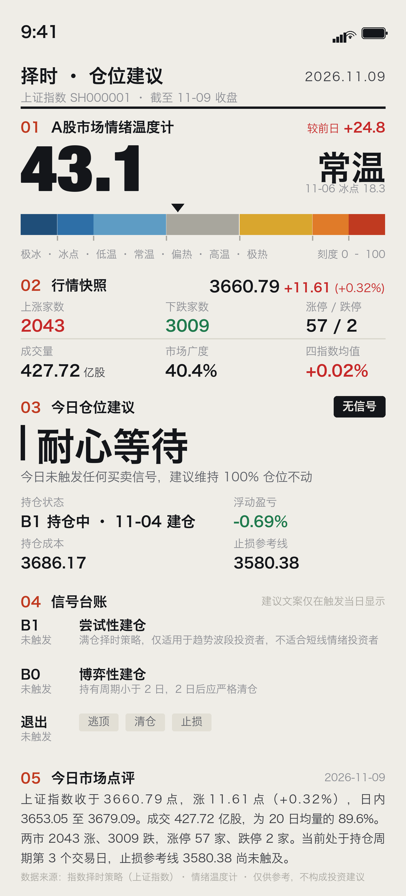

# a-share-position

A 股仓位管理 skill：一句话问「现在 A 股建议多少仓位」，直接返回一张固定版式的决策卡图片。

- 适用：宽基指数层面的整体仓位择时（满仓 / 空仓两档）
- 输出：PNG 决策卡，含市场温度、行情快照、建议仓位、信号台账、市场点评
- 依赖：只需 Python 3.8+；取数与计算用标准库，绘图的 Pillow **首次运行时自动安装**



## 安装

一行装好，没有后续步骤：

```bash
npx skills add andy-develop/a-share-position -g -y
```

`-g` 为全局安装（所有项目生效），去掉则装到当前项目。也可指定 agent：

```bash
npx skills add andy-develop/a-share-position -a claude-code -y     # 仅 Claude Code
npx skills add andy-develop/a-share-position --all -y              # 本机所有 agent
```

`skills` CLI 会自动识别本机已安装的 agent，把 skill 放到各自约定的目录
（`.claude/skills/`、`.agents/skills/`、`~/.workbuddy/skills/` 等），
因此同一份 skill 可跨 agent 通用。

### 关于 Pillow

`npx skills add` 只负责把文件放到对应目录，**不支持安装钩子**，所以 Python 依赖不能在这一步装。
本 skill 的做法是把安装推迟到首次运行：脚本启动时检测 Pillow，缺失就自动执行 pip 安装。

| 情况 | 行为 |
| --- | --- |
| 已装 Pillow | 直接出图 |
| 未装、可联网 | 首次运行自动安装后出图（约 40 秒，之后为秒级） |
| 未装、无网络 | 自动降级为文本版，并提示手动 `pip3 install pillow` |
| 想禁止自动安装 | `POSITION_NO_AUTO_INSTALL=1 python3 scripts/decide.py` |

### 手动安装（不使用 CLI）

```bash
git clone https://github.com/andy-develop/a-share-position.git
cp -R a-share-position ~/.claude/skills/a-share-position      # Claude Code
cp -R a-share-position ~/.workbuddy/skills/a-share-position    # WorkBuddy
```

## 使用

安装后直接对 agent 说：

- 「现在 A 股建议多少仓位？」
- 「今天要不要减仓？」
- 「我持仓成本 3700，现在怎么处理？」

也可以命令行直接跑：

```bash
python3 scripts/decide.py                       # 今日决策卡（输出 PNG 路径）
python3 scripts/decide.py --png out.png         # 指定输出路径
python3 scripts/decide.py --scale 3             # 3 倍图，更清晰
python3 scripts/decide.py --cost 3686.17        # 指定自己的持仓成本
python3 scripts/decide.py --text                # 同时打印纯文本版（兜底）
python3 scripts/decide.py --json                # 附带结构化字段
python3 scripts/decide.py --offline-dir ./data --asof 2026-11-09   # 回看历史
```

离线目录需包含：

- `index.csv`：`date,open,high,low,close,volume`（上证指数日线，建议 300 根以上）
- `breadth.csv`：`date,up,down,flat,zt,dt,idx_avg`

温度历史会追加写入 `data/temp_history.csv`，每天运行一次即自动补齐前一交易日的对比基准，
因此「较前日」的变化值从第二次运行起即为真实值。
图片默认写到 `output/position-card-YYYY-MM-DD.png`。

## 目录结构

```
a-share-position/
├── SKILL.md                  # skill 入口：触发条件、执行流程、输出约束
├── README.md
├── LICENSE                   # MIT
├── assets/
│   ├── card-template.md      # 固定版式与字段来源
│   └── sample-card.png       # 决策卡示例
├── scripts/
│   ├── decide.py             # 主入口：取数 → 计算 → 渲染卡片
│   ├── engine.py             # 温度模型与仓位状态机
│   ├── fetch.py              # 行情取数（多源回退）
│   └── render.py             # 图片排版（Pillow）
├── output/                   # 生成的 PNG（运行后出现，不入库）
├── references/
│   └── internal-model.md     # 内部判定模型（不对用户披露）
└── data/
    └── temp_seed.csv         # 温度历史种子
```

## 设计约定

1. **结论固定格式**：图片版式、字段、措辞统一，便于长期对照与截图留档。
2. **逻辑不外泄**：面向用户只输出结论，不解释判定过程、不暴露任何指标名称与参数。
3. **数字以脚本为准**：温度、仓位、风控位均由脚本计算，不允许人工估算或改写。
4. **仓位只有两档**：0% 与 100%，不做金字塔加减仓。

## 免责声明

本项目为规则化的仓位参考工具，输出不构成任何投资建议。策略为满仓择时，
仅适用于趋势波段投资者，不适合短线情绪投资者。行情数据来自公开接口，可能存在延迟或缺失。
